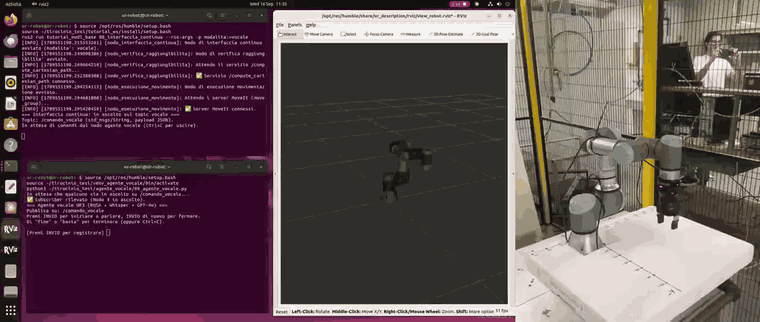
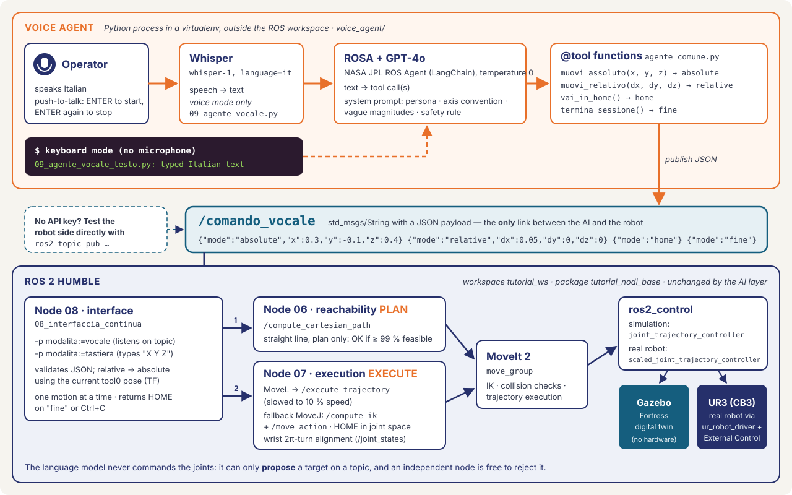
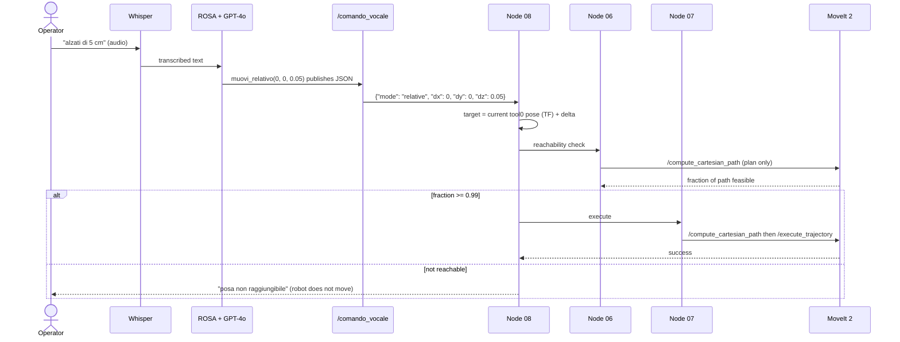

# UR3 Voice Control with ROS 2 and ROSA

**Move a Universal Robots UR3 by speaking Italian.** Whisper transcribes the operator, NASA JPL's
[ROSA](https://github.com/nasa-jpl/rosa) agent with GPT-4o turns the sentence into a tool call,
and a ROS 2 Humble / MoveIt 2 pipeline checks reachability before moving the arm — first on a
Gazebo digital twin, then on the real robot.

[](https://doi.org/10.5281/zenodo.XXXXXXX)
[](LICENSE)




*Real UR3 at the University of Brescia, sped up 4×. Commands spoken in Italian, e.g.
"alzati di 5 cm e vai a sinistra di 12" (rise 5 cm and go 12 cm left) and "destra 20"
(right 20 cm). Full-length video with audio: [`docs/media/demo_real_ur3.mp4`](docs/media/demo_real_ur3.mp4).*

> **No robot? Try it tonight in simulation** → [docs/simulation.md](docs/simulation.md).
> Level 1 (Gazebo + MoveIt, no API key) moves the simulated arm with plain `ros2 topic pub`;
> level 2 adds the language model.

---

## How it works



The system is split into two subsystems that share **one** ROS 2 topic, `/comando_vocale`
(`std_msgs/String` with a JSON payload):

* **Voice agent** (`voice_agent/`, plain Python in a virtualenv): push-to-talk recording →
  OpenAI Whisper → ROSA + GPT-4o, which may only call four tools: absolute move, relative move,
  go home, end session. Each tool publishes one JSON command.
* **Control subsystem** (`tutorial_ws/`, ROS 2 package `tutorial_nodi_base`): node 08 receives
  the command, node 06 verifies that the straight-line path to the target is ≥ 99 % feasible
  (MoveIt `/compute_cartesian_path`), and only then node 07 executes it, falling back to a
  joint-space move (IK seeded with the current state) if the straight line is not feasible.

The model never touches the joints: it can only *propose* a target, which an independent node
is free to reject. The same nodes work from the keyboard without any AI, and the AI layer was
added without changing a line of the control code.

<details>
<summary>Lifecycle of one command (sequence diagram)</summary>



</details>

The full system prompt, the tool definitions and the JSON protocol, verbatim and translated, are
in **[docs/prompts-and-tools.md](docs/prompts-and-tools.md)**.

## Quick start (simulation, Ubuntu 22.04 + ROS 2 Humble)

```bash
# 1. system packages
sudo apt install -y python3-colcon-common-extensions python3-rosdep python3-vcstool python3-venv \
  ros-humble-ur ros-humble-moveit ros-humble-ros-gz ros-humble-gz-ros2-control libportaudio2

# 2. workspace
git clone https://github.com/Piolini-Singh/ur3-voice-control-rosa.git
cd ur3-voice-control-rosa
source /opt/ros/humble/setup.bash
(cd tutorial_ws && vcs import src < dependencies.repos \
  && rosdep install --from-paths src --ignore-src -y --rosdistro humble && colcon build)

# 3. voice agent (only for the AI part)
./scripts/setup_venv.sh && nano .env          # OPENAI_API_KEY="sk-..."
```

Then, each in its own terminal (after `source /opt/ros/humble/setup.bash && source tutorial_ws/install/setup.bash`):

```bash
ros2 launch ur_simulation_gz ur_sim_control.launch.py ur_type:=ur3 launch_rviz:=false          # 1 Gazebo
ros2 launch ur_moveit_config ur_moveit.launch.py ur_type:=ur3 use_sim_time:=true launch_rviz:=true  # 2 MoveIt
ros2 run tutorial_nodi_base 08_interfaccia_continua --ros-args -p modalita:=vocale            # 3 node 08
ros2 topic pub --once /comando_vocale std_msgs/msg/String "{data: '{\"mode\": \"home\"}'}"    # 4a no AI
source venv_agente_vocale/bin/activate && python3 voice_agent/09_agente_vocale_testo.py       # 4b with AI
```

Step-by-step explanations, expected output and troubleshooting: [docs/simulation.md](docs/simulation.md).
Real robot (calibration, External Control, safety): [docs/real-robot.md](docs/real-robot.md).

## Repository layout

```text
.
├── voice_agent/                     # AI layer (not a ROS package, runs in a venv)
│   ├── agente_comune.py             # system prompt, 4 tools, ROS publisher, ROSA setup
│   ├── 09_agente_vocale.py          # microphone + Whisper + ROSA
│   ├── 09_agente_vocale_testo.py    # keyboard + ROSA (same tools and prompt)
│   ├── requirements.txt             # direct dependencies
│   └── requirements.lock            # exact venv used in the thesis experiments
├── tutorial_ws/                     # ROS 2 Humble colcon workspace
│   ├── dependencies.repos           # upstream UR Gazebo simulation (vcs import)
│   └── src/tutorial_nodi_base/      # nodes 01–08
├── docs/
│   ├── architecture.svg
│   ├── prompts-and-tools.md         # system prompt + tools + JSON protocol
│   ├── simulation.md                # reproduce without hardware
│   ├── real-robot.md                # UR3 CB3 setup and safety
│   └── media/                       # demo GIF and video
├── scripts/setup_venv.sh
├── .env.example                     # copy to .env (git-ignored) and add your key
├── CITATION.cff  ·  .zenodo.json    # citation metadata (Zenodo DOI)
└── LICENSE  ·  NOTICE
```

Identifiers and comments in the code are in Italian, as in the thesis; the documentation is in
English.

## The nodes

| # | Executable | What it does | Thesis § |
|---|---|---|---|
| 01 | `01_simple_publisher` | Minimal publisher on `input` | 3.3.1 |
| 02 | `02_simple_subscriber` | Prints `/joint_states` | 3.3.2 |
| 03 | `03_coordinatore_sorting` | Listens to two topics, captures the pose on "punto" | 3.3.3 |
| 04 | `04_muovi_ur3` | Sends one joint trajectory (`-p topic_traiettoria:=…`) | 3.4.1 |
| 05 | `05_smistatore_ur3` | `/input` "1"/"2" → rest/work pose (`-p topic_traiettoria:=…`) | 3.4.2 |
| 06 | `06_verifica_raggiungibilita` | Straight-line reachability check, never moves | 3.5.2 |
| 07 | `07_esegui_movimento_cartesiano` | MoveL execution, MoveJ fallback, HOME, 2π wrist alignment | 3.5.3 |
| 08 | `08_interfaccia_continua` | Keyboard `X Y Z` or `/comando_vocale` JSON; uses 06 + 07 | 3.5.4 |
| 09 | `voice_agent/09_agente_vocale*.py` | ROSA agent, keyboard or voice | 4.3–4.4 |

## Limitations and future work

* Motion only: position of the tool flange in Cartesian space, orientation kept constant; no
  gripper or vision yet (planned: gripper and cameras).
* Latency of a few seconds per command (two remote calls: transcription and interpretation), so
  suited to one command at a time, not continuous teleoperation.
* Requires Internet and a paid OpenAI API key; push-to-talk only (planned: local models and
  wake-word activation).
* Commands arriving during a motion are dropped, not queued.
* Validated on one UR3 CB3 with ROS 2 Humble on Ubuntu 22.04.

## Safety

This is research and teaching software, not a safety function. Validate every change in
simulation first, keep the emergency stop within reach and the workspace clear, and remember
that speech recognition and language models can be wrong. See [docs/real-robot.md](docs/real-robot.md).

## Citation

If you use this work, please cite it (the "Cite this repository" button uses
[`CITATION.cff`](CITATION.cff)):

```bibtex
@software{piolini_singh_2026_ur3_voice,
  author    = {Piolini, Matteo and Singh, Jaspreet},
  title     = {{UR3 Voice Control with ROS 2 and ROSA}},
  year      = {2026},
  publisher = {Zenodo},
  version   = {v1.0.0},
  doi       = {10.5281/zenodo.XXXXXXX},
  url       = {https://github.com/Piolini-Singh/ur3-voice-control-rosa}
}
```

Underlying thesis (Italian): M. Piolini, J. Singh, *Controllo vocale della movimentazione di un
manipolatore UR3 mediante ROS 2 integrato da IA e algoritmo di elaborazione del linguaggio
naturale "ROSA"*, Bachelor's thesis in Industrial Automation Engineering, University of Brescia,
A.Y. 2025/2026. Supervisor: Prof. Riccardo Adamini.

## License

* Code: [Apache License 2.0](LICENSE) © 2026 Matteo Piolini and Jaspreet Singh. See [NOTICE](NOTICE).
* Documentation, diagram and demo media (`docs/`): [CC BY 4.0](https://creativecommons.org/licenses/by/4.0/).
* Third-party software (ROS 2, MoveIt 2, Universal Robots packages, ROSA, LangChain, OpenAI SDK)
  is used as a dependency and is not redistributed here; each keeps its own license.

## Acknowledgements

Laboratorio di Meccanica Applicata, Department of Mechanical and Industrial Engineering (DIMI),
University of Brescia, and Prof. Riccardo Adamini. ROSA is developed by NASA JPL; the UR ROS 2
driver, description and simulation packages by Universal Robots and contributors.
